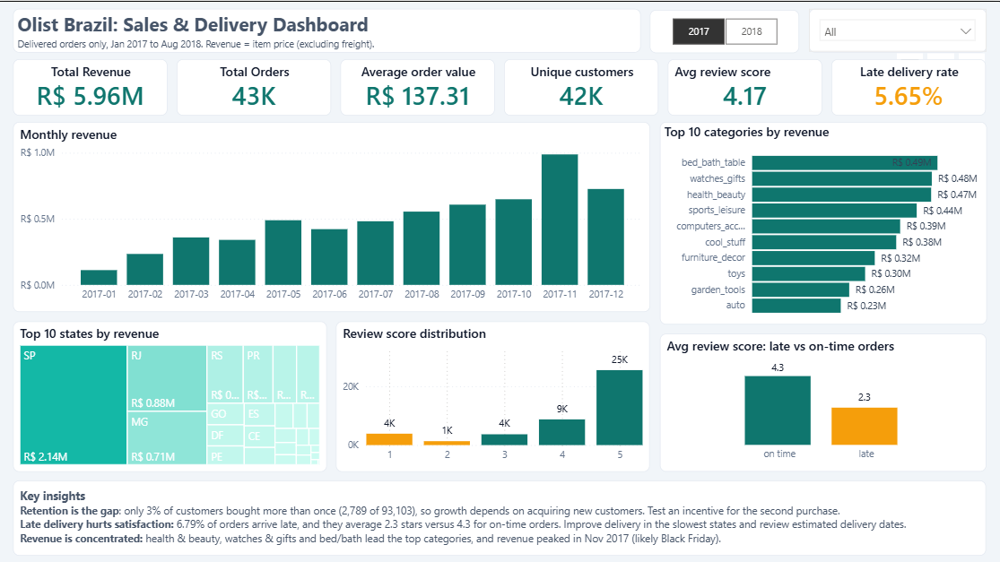

\# Olist Brazil E-Commerce Analysis

\## Project Overview

An e-commerce analytics project using the Olist Brazilian E-Commerce dataset to analyze sales, customer behavior, delivery performance, and customer satisfaction.

\## Tools

\- SQL Server

\- Power BI

\- Excel

\- Git and GitHub

\## Key Performance Indicators

\- Total Revenue

\- Total Orders

\- Average Order Value

\- Unique Customers

\- Average Review Score

\- Late Delivery Rate

\## Analysis

\- Monthly revenue trends

\- Top product categories by revenue

\- Revenue by Brazilian state

\- Review score distribution

\- Customer satisfaction for late versus on-time orders

\- Delivery performance

## Repository Structure
- `sql/` — SQL queries and business analysis
- `powerbi/` — Power BI report (.pbix)
- `docs/` — ERD and project documentation
- `images/` — Dashboard screenshots
- `README.md` — Project overview and documentation
- `.gitignore` — Excludes local source data and temporary files

\## Data Source

Olist Brazilian E-Commerce dataset. Original data files are kept locally and are not included in the repository.

## Dashboard Preview

